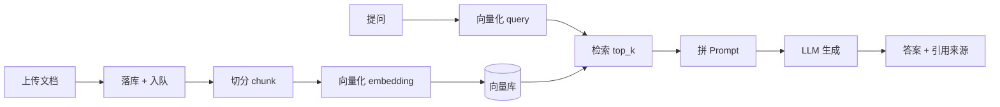

> 写一个 RAG 系统，网上教程一搜一大把，但大多让你 `pip install langchain` 然后三行代码出结果。结果出来了，链路还是黑的。
>
> 这篇文章反过来：不装任何 RAG 框架，用 FastAPI 把「文档上传 → 切分 → 向量化 → 检索 → 生成」五个环节**手写一遍**。写完你才知道，RAG 的本质没那么玄，核心就一句话。

## 先讲清楚 RAG 到底在解决什么

大模型的知识截止到训练那一刻，而且会一本正经地编造不存在的内容——这叫**幻觉**。

RAG（Retrieval-Augmented Generation，检索增强生成）的思路很朴素：**先把你自己的资料检索出来，再塞进 prompt 让模型照着答**。模型不知道的，检索给到；检索给的，模型照着说。幻觉从源头被压下去。

所以一个 RAG 系统的闭环长这样：



两条链路：**写入**（异步，走任务队列）和**读取**（同步，走 RAG 链路）。下面逐个环节拆。

## 环节一：切分（chunk），检索质量的第一道关口

文档不能整篇塞进向量库，要切成小块。为什么？因为 embedding 模型把一段文字压成一个向量，块太大，语义被稀释；块太小，上下文丢失。

```python
def chunk_text(text, chunk_size=500, overlap=50):
    chunks = []
    start = 0
    n = len(text)
    while start < n:
        end = min(start + chunk_size, n)
        chunks.append(text[start:end])
        if end >= n:
            break
        start = end - overlap   # 关键：重叠，防止边界信息丢失
    return chunks
```

::: note
overlap（重叠）为什么重要：一句话被硬切在边界处时，前半句在上一块的末尾、后半句在下一块的开头，任何一块单独检索都拿不到完整语义。重叠让边界内容重复出现，保住上下文。
:::

## 环节二：向量化（embedding），把文字变成可计算的距离

切完块，要把每块文字变成向量。向量化的本质是：**语义相近的文本，向量距离更近**。

这一步工程上有个铁律，踩过的都懂：

::: warning
入库和查询必须用同一个 embedding 模型。否则两边的向量不在同一个空间里，算出来的相似度全部失真，检索结果随机。
:::

工程上用一个工厂函数锁死模型选择，避免「入库用 A、查询用 B」的事故：

```python
def get_embedder(provider: str) -> Embedder:
    if provider == "mock":
        return MockEmbedder()      # 本地零依赖跑通链路
    # 生产：OpenAI / 通义 / Ollama 兼容接口
```

## 环节三：检索（retrieve），找最相关的几块

查询向量和所有切片向量算相似度，取 top_k。教学版用 numpy 余弦相似度，一眼看懂本质：

```python
def cosine_similarity(a, b):
    return float(np.dot(a, b) / (np.linalg.norm(a) * np.linalg.norm(b)))
```

::: note
生产别在内存里全量扫。换 pgvector 的 `ORDER BY embedding <=> :q LIMIT :k`，或 Qdrant/Milvus 的 ANN 索引（HNSW），逻辑不变，只是把「算相似度」下推到数据库/向量库内。
:::

## 环节四：拼 Prompt，把检索结果塞进去

检索到的几块内容，按编号拼进 user message，并给模型立规矩：

```python
SYSTEM_PROMPT = "只根据提供的上下文回答；没有的信息，如实说不知道，不要编造。"

user = f"上下文：\n{block}\n\n问题：{question}\n请基于上下文回答，并标注引用编号。"
```

这一句「只依据上下文 + 标注引用编号」，是抑制幻觉**最便宜有效**的手段。

## 环节五：LLM 生成，最后一步反而最简单

前四步做对了，这步就是调一次 `chat/completions`。抽象成基类 + 工厂，mock 模式把检索到的上下文直接回显，专门用来验证「检索」环节有没有生效。

## 两个让工程「像工程」的决策

光有五个环节还不够，两个工程决策让这套东西能上生产。

**决策一：耗时活移出请求线程。** 切分 + 向量化是重活，如果放在上传接口里同步做，大文档直接把 API 卡死。正确姿势是上传只「落库 + 入队」，交给 Celery 异步做：

| 层 | 选型 | 为什么 |
|---|---|---|
| 异步任务 | Celery + Redis | 切分/向量化是重活，移出请求线程 |
| 定时任务 | APScheduler + Celery Beat | 进程内轻量任务与分布式周期任务互补 |
| 向量检索 | numpy → pgvector | 教学用内存余弦，生产用库内 ANN |

**决策二：默认零依赖可跑。** 本地没 Redis、没 API Key 也能把链路跑通——用 SQLite + mock embedding/LLM + eager 模式。等要接真实模型，只改工厂函数，业务层一行不动。

这正是分层 + 抽象基类的价值：**换实现，不动结构**。

## 一个能跑的最小闭环

完整工程我放在文末，结构长这样：

```text
app/
├── main.py          # 入口 + lifespan
├── core/            # 配置 / DB / Celery
├── models/          # Document / Chunk / IndexTask
├── api/             # 路由 + 依赖注入
├── rag/             # chunker / embedder / retriever / prompt / llm
├── services/        # 组装 RAG 链路
└── tasks/           # Celery 异步任务 + 派发层
```

启动、上传、提问三行搞定：

```bash
uv run uvicorn app.main:app --reload
curl -X POST http://127.0.0.1:8000/documents/upload -F "file=@readme.md"
curl -X POST http://127.0.0.1:8000/chat -d '{"question":"这个项目用什么 ORM？"}'
```

返回答案 + 引用来源，文档状态从 `pending` 走到 `ready`，闭环完成。

## 总结

RAG 的本质就一句话：**检索给答案兜底，答案由检索决定上限**。

五个环节里，切分和向量化是地基，检索是核心，prompt 是安全阀，LLM 只是最后一步。把检索链路做对了，再谈模型才有意义。

> 下一篇文章，我会把这个闭环的「检索」环节升级成 pgvector + 混合检索（BM25 + 向量）+ rerank，讲讲精度是怎么一步步提上去的。工程源码见文末引用，欢迎拿去跑。

::: note
如果你也在用 FastAPI 做后端，建议先读官方文档的 async 和 lifespan 两节，再回来看这套结构，会顺畅很多。
:::
