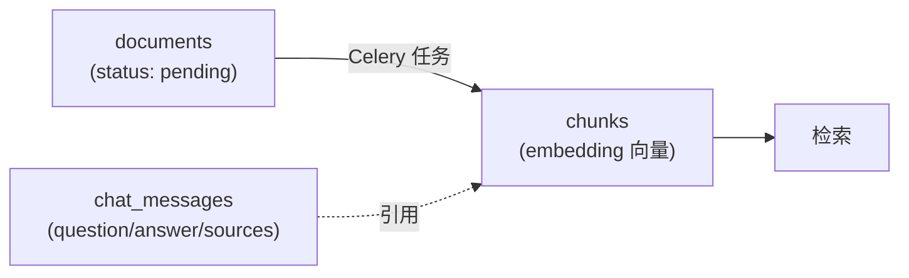

> 本系列《从零手写一个 FastAPI RAG 问答系统》，RAG 是贯穿项目，主角是工程栈。前两篇搭好了框架，这一篇装数据层：**表怎么设计、ORM 怎么映射、问答记录怎么落库、向量距离在 SQL 里长什么样**。
>
> 数据层是工程的腰。表设计错了，后面每一层都在还债。

## RAG 系统要哪几张表

结合主题倒推。一个 RAG 问答系统要干四件事：存文档、存切片、存问答记录、追踪索引任务。每件事一张表：

| 表 | 装什么 | 关键字段 |
|---|---|---|
| documents | 上传的原始文档 | filename / content / status |
| chunks | 切分后的文本块 + 向量 | document_id / content / embedding / chunk_index |
| chat_messages | 每次问答的记录 | session_id / question / answer / sources |
| index_tasks | 索引任务状态（幂等用） | document_id / status / error |

两条链路把四张表串起来：



文档从 `pending` 走到 `ready`，切片跟着生成；用户提问命中切片，问答连同引用来源一起落进 chat_messages。

## 建表一：documents，文档表

SQLAlchemy 2.0 推荐的声明式写法是 `Mapped` + `mapped_column`，类型标注即映射：

```python
import uuid
from datetime import datetime
from sqlalchemy import DateTime, String, Text, func
from sqlalchemy.orm import Mapped, mapped_column
from app.core.db import Base

def _uuid() -> str:
    return str(uuid.uuid4())

class Document(Base):
    __tablename__ = "documents"

    id: Mapped[str] = mapped_column(String(36), primary_key=True, default=_uuid)
    filename: Mapped[str] = mapped_column(String(255), index=True)
    content: Mapped[str] = mapped_column(Text)
    # pending -> indexing -> ready | failed
    status: Mapped[str] = mapped_column(String(20), default="pending", index=True)
    created_at: Mapped[datetime] = mapped_column(
        DateTime(timezone=True), server_default=func.now()
    )
```

逐行拆映射要点：

- **主键用应用侧生成的 uuid**：`default=_uuid` 在 Python 侧生成，不依赖数据库自增。分库分表、多服务写同一库时不用协调序列；
- **状态字段建索引**：`status` 是所有查询的过滤条件（列表页按状态查、任务扫 `pending`），没有索引就是全表扫；
- **时间戳用 `server_default=func.now()`**：由数据库生成，避免应用服务器时钟不一致。

## 建表二：chunks，切片 + 向量

```python
from sqlalchemy import Integer

class Chunk(Base):
    __tablename__ = "chunks"

    id: Mapped[str] = mapped_column(String(36), primary_key=True, default=_uuid)
    document_id: Mapped[str] = mapped_column(String(36), index=True)
    content: Mapped[str] = mapped_column(Text)
    # 教学简化：JSON 序列化的向量；生产换 pgvector 的 Vector 类型，见后文
    embedding: Mapped[str | None] = mapped_column(Text, nullable=True)
    chunk_index: Mapped[int] = mapped_column(Integer)
```

`document_id` 建索引：检索结果要按切片反查文档来源，切片表按文档聚合，这个字段是高频过滤列。教学版向量存 JSON 文本是为了零依赖跑通——生产换 `Vector(1536)` 列类型，第五篇展开。

## 建表三：chat_messages，问答记录（结合主题的新表）

这是问答系统的核心业务表，每次 `/chat` 落一条：

```python
from sqlalchemy import Index

class ChatMessage(Base):
    __tablename__ = "chat_messages"

    id: Mapped[str] = mapped_column(String(36), primary_key=True, default=_uuid)
    # 会话分组：前端生成一个 uuid 传进来，同一会话的多轮问答共享它
    session_id: Mapped[str] = mapped_column(String(36), index=True)
    question: Mapped[str] = mapped_column(Text)
    answer: Mapped[str] = mapped_column(Text)
    # JSON 文本：[{"document_id": ..., "content": ..., "score": ...}, ...]
    sources: Mapped[str] = mapped_column(Text, default="[]")
    created_at: Mapped[datetime] = mapped_column(
        DateTime(timezone=True), server_default=func.now()
    )

    __table_args__ = (
        Index("ix_chat_session_created", "session_id", "created_at"),
    )
```

这张表有三个设计决策值得讲：

- **session_id 做会话分组**：多轮对话是 RAG 产品的标配，前端生成一个 uuid 传给接口，同一会话共享。要渲染对话历史，按 `session_id` + 时间排序取出来就是完整上下文；
- **sources 存 JSON 而不是关联表**：引用来源是切片 id + 分数的快照。如果建关联表，切片被删除后历史记录就断了引用；存 JSON 快照，历史永远可回放；
- **联合索引 `(session_id, created_at)`**：会话历史的查询模式固定是「某会话按时间倒序」，单列索引不如联合索引一步到位。

::: note
问答记录不只是「历史记录」功能，它同时是第六篇评测的原料：真实用户的问题 + 系统的回答 + 命中的切片，攒起来就是黄金评测集的来源。表设计时就要想到下游用途。
:::

## 落库实战：/chat 接口怎么写这张表

模型建好，落库就是三行：

```python
@router.post("", response_model=ChatResponse)
async def chat(req: ChatRequest, db: AsyncSession = Depends(get_db)) -> ChatResponse:
    answer, sources = await answer_question(db, req.question)

    # sources 在服务层是 list[dict]，直接序列化成 JSON 快照
    db.add(
        ChatMessage(
            session_id=req.session_id or "",
            question=req.question,
            answer=answer,
            sources=json.dumps(sources, ensure_ascii=False, default=str),
        )
    )
    await db.commit()      # 不 commit，数据静默丢失——没有任何报错
    return ChatResponse(answer=answer, sources=sources)
```

注意最后一行 `await db.commit()`。SQLAlchemy 的会话是**工作单元**模式：所有改动攒着，commit 一次性落库，rollback 一次性放弃。**async 会话里忘了 commit，数据就静默丢失**——这是同步转 async 最容易漏的地方。

会话本身由依赖注入管理，一个请求一个：

```python
async def get_db() -> AsyncGenerator[AsyncSession, None]:
    async with async_session_factory() as session:
        yield session      # 请求处理完自动关闭

# 进程级单例，别在函数里反复 create_async_engine
engine = create_async_engine(settings.database_url)
async_session_factory = async_sessionmaker(engine, expire_on_commit=False)
```

`expire_on_commit=False` 不是优化项：默认值下 commit 后对象属性被标记过期，下次访问会触发懒加载查库，而懒加载在事件循环里跑不起来，直接抛 `MissingGreenlet`。

## 向量距离的 SQL 映射：相似度是这么算的

这是 RAG 工程特有的映射——`embedding` 不是普通字段，是向量；查询也不只是 WHERE 过滤，而是**按距离排序取 top-k**。SQL 长这样：

```sql
SELECT id, content
FROM pg_chunks
ORDER BY embedding <=> :query_vec   -- <=> 是余弦距离算子
LIMIT 5
```

pgvector 提供三个距离算子：

| 算子 | 含义 | 方向 |
|---|---|---|
| `<->` | L2（欧氏）距离 | 越小越近 |
| `<=>` | 余弦距离 | 越小越近 |
| `<#>` | 负内积 | 越小越近（内积取负） |

SQLAlchemy 2.0 的映射写法——`Vector` 列类型 + 距离方法，ORM 替你拼算子：

```python
from pgvector.sqlalchemy import Vector

VECTOR_DIM = 1536   # 跟 embedding 模型锁死

class PgChunk(PgBase):
    __tablename__ = "pg_chunks"
    embedding = mapped_column(Vector(VECTOR_DIM), nullable=False)

def build_cosine_search(query_vec: list[float], k: int = 5):
    if len(query_vec) != VECTOR_DIM:
        raise ValueError(f"query 向量维度 {len(query_vec)} != {VECTOR_DIM}")
    return (
        select(PgChunk.id, PgChunk.content)
        .order_by(PgChunk.embedding.cosine_distance(query_vec))  # <=> 算子
        .limit(k)
    )
```

三个细节值得较真：

- **维度在发查询前校验**。`query_vec` 长度和列定义不一致，PostgreSQL 会报维度错误——但错误发生在数据库往返之后。发之前就 raise，省一次白跑的 IO；
- **距离升序就是相似度降序**。`<=>` 算的是「距离」，越小越近，`ORDER BY` 默认升序正好。别看着「相似度」三个字就写 `DESC`——方向写反，top-k 变成最不相关的 k 条，还不报错；
- **编译期就能验证 SQL 形状**。`stmt.compile(dialect=postgresql.dialect())` 不需要真起数据库，断言 `<=>`、`ORDER BY`、`LIMIT` 都在，改代码时一眼看出 SQL 变形没有。

::: warning
教学工程默认跑 SQLite + JSON 存向量 + numpy 算相似度，那是为了零依赖可跑。生产必须把距离计算下推到 pgvector——把全部向量拉回进程里逐个算，是 O(n) 次 Python 循环加 O(n) 次网络传输，量一上来先死的是应用服务器不是数据库。
:::

## 迁移：create_all 只配教学

工程里 `init_db()` 用 `Base.metadata.create_all` 建表，是教学简化。**生产必须用 Alembic**，它做的是「版本化演进」——每次表结构变更是一个可回滚的迁移脚本：

```bash
alembic revision --autogenerate -m "add chat_messages table"
alembic upgrade head           # 上线执行
alembic downgrade -1           # 回滚一步
```

三件事必须做：迁移脚本进版本库和代码一起 review；每次改模型就生成迁移，禁止手工改生产表；加表（比如这次的 chat_messages）跟着迁移走，别在数据库里手工 CREATE TABLE。

## 常见坑清单

| 坑 | 现象 | 纠正 |
|---|---|---|
| 忘 commit | 数据静默丢失 | 明确 commit 责任方 |
| 函数里建 engine | 连接数暴涨 | engine 进程级单例 |
| commit 后访问属性炸 MissingGreenlet | async 懒加载 | expire_on_commit=False |
| 会话跨请求复用 | 脏数据串请求 | session-per-request |
| 手工改生产表 | 环境不一致 | Alembic 迁移 |
| 向量拉回进程算距离 | O(n) 循环 + 全量传输 | pgvector 库内 ORDER BY 距离 |
| 距离排序方向写反 | top-k 返回最不相关 | 距离升序，别写 DESC |

## 总结

数据层四张表撑起 RAG 系统：documents 管原始文档，chunks 管切片和向量，chat_messages 管问答记录（同时是评测原料），index_tasks 管任务幂等。

映射的套路可以浓缩成一句：**主键应用侧生成、高频过滤列建索引、会话历史用联合索引、引用来源存 JSON 快照**。向量距离是 RAG 特有的映射——pgvector 的 `Vector` 列 + `<=>` 算子，top-k 一条 SQL 在库内算完。

> 下一篇装任务队列：切分和向量化为什么不能放在上传接口里做、Celery + Redis 怎么搭、任务幂等和定时清理怎么做。

::: note
文中建表与映射代码全部来自可运行工程，chat_messages 表已在 /chat 接口真实落库。工程源码见文末引用。
:::
