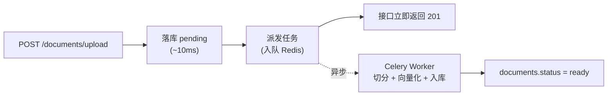

> 本系列《从零手写一个 FastAPI RAG 问答系统》，RAG 是贯穿项目，主角是工程栈。第一篇的链路里有个关键角色被一笔带过：后台任务。这一篇把它讲透——**Celery 怎么搭、任务怎么写才幂等、Redis 扮演什么角色、定时清理怎么做**。
>
> 这是整个系列里最「生产向」的一篇：本地能降级跑，上线能横向扩。

## 为什么上传接口不能同步干活

算一笔账。一个 10 MB 的文档：切分 ~10ms，但向量化要调 embedding API——500 个切片 × 每次 100ms 网络 IO = **近一分钟**。HTTP 请求早就超时了，客户端重试，服务端还在算，雪崩。

所以第一篇的决策一：**上传接口只做「落库 + 派发」，重活扔给任务队列**。



接口响应时间从分钟级变成毫秒级，索引进度客户端轮询 `/documents` 看 `status` 字段就行。

## Celery 起盘：一个实例文件

```python
from celery import Celery
from app.core.config import settings

celery_app = Celery(
    "fastapi_rag",
    broker=settings.celery_broker_url,        # redis://localhost:6379/0
    backend=settings.celery_result_backend,   # redis://localhost:6379/1
    include=["app.tasks.indexing"],
)

celery_app.conf.update(
    task_always_eager=settings.celery_task_always_eager,
    task_track_started=True,
    task_serializer="json",
    accept_content=["json"],
    timezone="Asia/Shanghai",
    enable_utc=True,
)
```

Redis 在这套架构里扮演**两个角色**：

| 角色 | 配置项 | 存什么 |
|---|---|---|
| Broker（队列） | celery_broker_url | 待执行的任务消息，worker 从这里取 |
| Result Backend | celery_result_backend | 任务执行结果，供查询 |

第三个角色是**缓存**（FastAPI 直接用 Redis 缓存热点数据），本工程没用到，但同一个 Redis 实例用不同 db 号就能承担：broker 用 db 0，backend 用 db 1，互不干扰。

::: note
task_track_started=True 值得开。默认 Celery 只记录 PENDING/SUCCESS/FAILURE，开了之后任务一开始执行就标记 STARTED——排查「任务卡住了还是还没被领走」时，这个状态就是分水岭。
:::

## 任务编写：切分 + 向量化 + 入库

Celery 任务入口必须是**同步函数**，但我们的数据层全是 async（SQLAlchemy 2.0 async）。桥接方式是 `asyncio.run`：

```python
@celery_app.task(name="app.tasks.indexing.index_document")
def index_document(document_id: str) -> str:
    asyncio.run(_index(document_id))     # 同步入口包异步逻辑
    return document_id

async def _index(document_id: str) -> None:
    async with async_session_factory() as db:
        doc = await db.get(Document, document_id)
        if doc is None:
            return
        task = IndexTask(document_id=document_id, status="running")
        db.add(task)
        doc.status = "indexing"
        await db.commit()

        try:
            embedder = get_embedder(settings.embedding_provider)
            chunks = chunk_text(doc.content, settings.chunk_size, settings.chunk_overlap)
            embeddings = await embedder.embed(chunks)

            for i, (text, emb) in enumerate(zip(chunks, embeddings)):
                db.add(Chunk(document_id=document_id, content=text,
                             embedding=json.dumps(emb), chunk_index=i))

            task.status = "done"
            doc.status = "ready"
            await db.commit()
        except Exception as exc:
            await db.rollback()
            doc = await db.get(Document, document_id)
            task.status = "failed"
            task.error = str(exc)[:500]
            if doc is not None:
                doc.status = "failed"
            await db.commit()
            raise    # re-raise，让 Celery 也记为 FAILURE
```

这段代码里藏着四个工程决策：

**1. 任务状态落库（IndexTask 表）。** 不靠 Celery 自己的结果存储，任务跑到哪一步、失败原因是什么，查表就知道。这就是幂等的基础：任务重跑前先查状态，`done` 的直接跳过。

**2. 文档状态机。** `pending → indexing → ready | failed`，每个状态转移都显式 commit。客户端轮询状态字段就能画进度条。

**3. 失败要「留证据」。** rollback 后重新取 doc，把异常文本截断 500 字存进 `task.error`，文档置 `failed`。没有这一步，失败的任务就消失了，只剩 Redis 里一条没人看的日志。

**4. 异常 re-raise。** 业务表记完失败还要把异常抛回去，Celery 才会把任务标为 FAILURE，重试和告警机制才能接手。

::: warning
异常里必须先 rollback 再改状态。rollback 之前的会话带着半成品数据（写了一半的 Chunk），直接往上面改 task.status 会把脏数据一起 commit 进去。rollback → 重新 get → 改状态 → commit，这个顺序不能乱。
:::

## eager 降级：本地没有 Redis 也能跑

开发机上不想装 Redis？`task_always_eager=True` 让 `delay()` 变成**同步函数调用**——任务在请求进程里直接执行，不经过队列。

但这一降级立刻踩到一个坑：任务内部是 `asyncio.run()`，而上传接口本身跑在 FastAPI 的事件循环里。事件循环里再 `asyncio.run()`，直接抛 `asyncio.run() cannot be called from a running event loop`。

解法是加一层**派发层**，屏蔽两种模式的差异：

```python
async def dispatch_index(document_id: str) -> None:
    if settings.celery_task_always_eager:
        await _index(document_id)          # eager：直接 await 异步逻辑
    else:
        index_document.delay(document_id)  # 生产：入队，worker 里 asyncio.run
```

业务代码只调 `dispatch_index`，永远不知道底下是同步还是异步。这个抽象只有 8 行，但它同时解决了两件事：本地开发零依赖、生产无缝切真队列——只动 `CELERY_TASK_ALWAYS_EAGER` 一个环境变量。

::: note
「业务代码不感知任务执行模式」是这条抽象的核心收益。eager 只用于开发调试，它失去了队列的全部意义（削峰、隔离、重试），上线必须置 false。
:::

## Beat 定时任务：失败的文档别让它堆着

索引失败是常态（网络抖动、embedding 服务超时），失败文档堆在表里没人管，检索时还会被扫到。用 Celery Beat 声明周期清理：

```python
celery_app.conf.beat_schedule = {
    "cleanup-failed-docs-every-10-min": {
        "task": "app.tasks.indexing.cleanup_failed_docs",
        "schedule": 600.0,
    },
}

@celery_app.task(name="app.tasks.indexing.cleanup_failed_docs")
def cleanup_failed_docs() -> int:
    return asyncio.run(_cleanup_failed())
```

Beat 是独立的调度进程，到点把任务扔进队列，worker 领走执行——**定时和执行分离**，worker 挂了任务也不会丢，恢复后继续消费。

进程内还有一套 APScheduler（`AsyncIOScheduler`），两者分工：

| | APScheduler | Celery Beat |
|---|---|---|
| 跑在哪 | API 进程内 | 独立 beat 进程 + worker 执行 |
| 适合 | 轻活：统计、打日志 | 重活：清理、重建索引 |
| 扩容 | 跟 API 副本走，多副本会重复跑 | 单 beat 调度，不重复 |

::: warning
APScheduler 跑在 API 进程里，多个副本就跑多份——统计类重复跑无害，但写操作（清理、补数据）必须交给 Beat。async 环境用 APScheduler 必须选 AsyncIOScheduler，普通 BackgroundScheduler 会阻塞事件循环。
:::

## 跑起来

```bash
# 本地降级模式（无 Redis）：.env 里 CELERY_TASK_ALWAYS_EAGER=true，直接起 API
uv run uvicorn app.main:app --reload

# 生产模式：起 Redis，然后三个进程
celery -A app.core.celery_app.celery_app worker --loglevel=info
celery -A app.core.celery_app.celery_app beat --loglevel=info
uv run uvicorn app.main:app --host 0.0.0.0
```

worker 的 `--concurrency` 默认等于 CPU 核数。任务以 IO 为主（调 embedding API）时可以调大，CPU 密集就别超核数—— 第七篇用 Docker Compose 把 api/worker/beat 三个进程编排在一起。

## 总结

Celery + Redis 这一篇的核心就四条：

1. **耗时活出请求线程**：上传接口只落库 + 派发，毫秒级返回；
2. **任务幂等靠状态表**：IndexTask 记录状态与错误，失败留证据，重跑可跳过；
3. **eager 降级要加派发层**：业务代码不感知执行模式，本地零依赖可跑；
4. **定时任务分工明确**：轻活 APScheduler 进程内，重活和写操作交给 Beat。

> 下一篇回到 RAG 本身：内存全量扫是教学玩具，怎么升级到 pgvector + 混合检索 + rerank，精度一步步提上去。

::: note
文中任务代码全部来自可运行工程，eager 模式下上传 → 索引 → 问答链路已跑通。工程源码见文末引用。
:::
