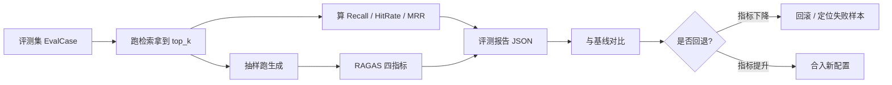

> 本系列《从零手写一个 FastAPI RAG 问答系统》，RAG 是贯穿项目，主角是工程栈。上一篇做完三层检索升级，但有个问题没回答：**你怎么知道精度真的上去了？**
>
> 换个 embedding 模型、调个 top_k、加不加 rerank，凭什么说哪个更好？答案只有一个：评测。这一篇把感觉变成数字。

## 为什么评测是 RAG 的地基

三个不做评测就必然发生的事故：

| 事故 | 现象 |
|---|---|
| 调参变玄学 | 换个参数感觉更好，上量后发现更差 |
| 劣化无感知 | 换了模型版本、改了切分策略，指标掉了没人知道 |
| 无法沟通 | 「我觉得准了」说服不了任何人，上线评审过不了 |

评测要在动手优化之前做——先测基线，才知道改进是真是假。这跟性能优化是同一个道理：先量瓶颈，再谈方案。

## 先测检索层：便宜、快速、信号最强

检索层评测只看一件事：**正确的切片有没有被捞回来、排第几**。不需要调 LLM，跑一遍检索就能算，是性价比最高的一层。

三个指标，各有分工：

| 指标 | 回答的问题 | 对什么敏感 |
|---|---|---|
| Recall@k | 该找到的，找到了多少 | 召回能力 |
| Hit Rate@k | 有多少查询至少答对一次 | 可用性底线 |
| MRR | 正确答案排第几 | 排序质量 |

公式都简单到可以在纸上算：

```text
Recall@k   = |retrieved ∩ relevant| / |relevant|
Hit Rate@k = 1（top_k 里至少一个正确）或 0
MRR        = 1 / 第一个正确结果的排名（未命中记 0）
```

实现就是三段短代码，关键是想清楚语义：

```python
def recall_at_k(retrieved, relevant, k):
    """该找到的找到了多少。relevant 为空时无从判断，返回 0.0。"""
    if not relevant:
        return 0.0
    hit = len(set(retrieved[:k]) & relevant)
    return hit / len(relevant)

def hit_rate_at_k(retrieved, relevant, k):
    """至少答对一次：1.0 / 0.0。批量平均后是「可用查询比例」。"""
    return 1.0 if set(retrieved[:k]) & relevant else 0.0

def mrr(retrieved, relevant):
    """排序质量：第一个正确答案的倒数排名。"""
    for rank, doc_id in enumerate(retrieved, start=1):
        if doc_id in relevant:
            return 1.0 / rank
    return 0.0
```

::: note
三个指标只报平均值是不够的。平均召回 0.85 可能意味着大部分查询 100% 召回、少数长尾查询全军覆没。报告里加一个 min_recall 或 P10 分位，长尾问题立刻现形。
:::

## 再测生成层：RAGAS 的四个指标

检索对了，答案不一定对。生成层评测看的是 LLM 拿检索结果干了什么，业界常用 RAGAS 框架，四个指标各管一段：

| 指标 | 检测什么 | 不达标意味着 |
|---|---|---|
| faithfulness | 答案是否忠于检索到的上下文 | 幻觉：模型在编 |
| answer_relevancy | 答案是否切题 | 答非所问 |
| context_precision | 检索结果里有用内容的排序质量 | 噪声切片排太前 |
| context_recall | 检索是否覆盖答案所需信息 | 该捞的没捞到 |

注意 context_precision / context_recall 是**用生成层视角反推检索质量**，和上一节的离线指标互补：离线指标依赖黄金标注，这两个不需要标注，但要调 LLM 判断。

::: warning
生成层评测靠 LLM-as-judge，每次都要调模型，有成本也有噪声。别全量跑，抽样跑（每轮 50~100 条）；judge 模型别用被评测的同一个模型，自己评自己分数会虚高。
:::

## 评测集怎么建：黄金集决定一切

评测的质量上限是标注的质量上限。垃圾标注 → 垃圾指标 → 垃圾决策。

一条评测样本长这样，字段分开、语义明确：

```python
@dataclass(frozen=True)
class EvalCase:
    query: str                          # 用户问题
    relevant_ids: frozenset[str]        # 标注的正确切片 id
    reference_answer: str = ""          # 参考答案（生成层评测用）
```

样本来源按价值排序：

1. **真实用户 query 日志**——最值钱，分布最真，长尾最全；
2. **人工构造**——覆盖已知重要场景，成本高但质量高；
3. **LLM 生成**——可扩量，但必须人工校验后才能进黄金集。

这里能接上第三篇的伏笔：`chat_messages` 表里攒的问答记录，就是第一类来源——真实问题、系统回答、命中切片都在，天然是评测原料。

规模建议：先 50~200 条起步，够看出趋势就够用。别一开始就追求大几千条，标注质量下降得不偿失。

::: note
评测集要和调参数据严格分开。拿评测集反复调参就是在过拟合评测集，指标越来越好看，线上越来越差。留一个 never-touch 的 holdout 集，只在关键节点跑。
:::

## 评测流水线：跑一遍出报告

把评测固化成流水线，而不是每次手动看日志：



主干代码用上一节的指标聚合，输出一份可比对的报告：

```python
def evaluate_retrieval(cases, results, k=5):
    recalls, hits, rrs = [], [], []
    for case, retrieved in zip(cases, results):
        recalls.append(recall_at_k(retrieved, case.relevant_ids, k))
        hits.append(hit_rate_at_k(retrieved, case.relevant_ids, k))
        rrs.append(mrr(retrieved, case.relevant_ids))
    return {
        "recall_at_k": mean(recalls),
        "hit_rate_at_k": mean(hits),
        "mrr": mean(rrs),
        "min_recall": min(recalls),   # 长尾下限
        "cases": len(cases),
    }
```

报告存 JSON，每次改动跑一遍，和基线 diff。**指标下降就是回退信号**，不要靠印象做决定。

## 四个最常见的误区

| 误区 | 后果 | 纠正 |
|---|---|---|
| 只看平均值 | 长尾问题被掩盖 | 报 min / P10 分位，看失败样本 |
| 评测集和调参集混用 | 过拟合评测集 | 留 holdout，只在关键节点跑 |
| LLM 生成评测集不校验 | 垃圾标注污染指标 | 人工抽检后才进黄金集 |
| 追单一指标 | 召回上去了排序崩了 | 三指标一起看，取舍要显式 |

还有一个隐性误区：**评测只做一次**。评测不是上线前的仪式，是持续的事——换模型、换切分、换检索策略，都要重跑。下一篇讲怎么把它搬到线上。

## 总结

RAG 的「准」是可以量化、必须量化的。检索层三个指标（Recall@k、Hit Rate@k、MRR）便宜快速，先做；生成层 RAGAS 四指标看端到端，抽样做；评测集是上限，标注质量优先于规模。

流程上只有一条铁律：**先测基线，再做优化，改动必回归**。没有这三步，前面几篇讲的所有升级都无从验证。

> 最后一篇讲上线：Docker Compose 把 api / worker / beat / PostgreSQL / Redis 一条命令拉起来，评测从一次性动作变成常驻机制。

::: note
本文指标实现（Recall@k、Hit Rate@k、MRR、批量聚合）是可运行代码。工程源码见文末引用，直接可接进你自己的检索链路。
:::
