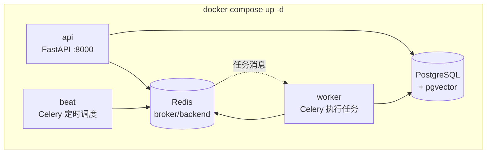

> 本系列《从零手写一个 FastAPI RAG 问答系统》，RAG 是贯穿项目，主角是工程栈。六篇下来：链路跑通、框架搭好、数据层装完、任务队列接上、检索升级、评测量化。这一篇收官：**把所有东西装进容器，一条命令拉起整套系统**。

## 部署形态：五个容器各司其职

先看全景。整套系统拆成五个容器，职责互不重叠：



关键点：**api、worker、beat 是同一份代码的三种启动方式**，不是三份代码。镜像只构建一次，`command` 决定容器里跑什么进程——这是容器化部署省资源的核心手法。

## Dockerfile：多阶段构建，依赖层吃缓存

```dockerfile
FROM python:3.12-slim AS base
WORKDIR /app

# 依赖层：pyproject 不变则命中缓存
COPY pyproject.toml uv.lock* ./
RUN pip install --no-cache-dir uv && uv pip install --system .

# 代码层
COPY app ./app

EXPOSE 8000
CMD ["uvicorn", "app.main:app", "--host", "0.0.0.0", "--port", "8000"]
```

分层顺序是刻意安排的：`COPY pyproject.toml` 在 `COPY app` 之前。Docker 的构建缓存按层匹配——**代码天天改，依赖不常动**，把依赖层放前面，改代码后重建只走最后一层 COPY，几秒出镜像。反过来写，每次改一行代码都要重装全部依赖。

::: note
uv.lock 进镜像意味着构建可复现：今天构建和三个月后构建，依赖版本完全一致。「在我机器上是好的」这类事故从源头消失。
:::

## docker-compose.yml：一条命令拉起整套

```yaml
services:
  db:
    image: pgvector/pgvector:pg16        # 自带 pgvector 扩展
    environment:
      POSTGRES_USER: rag
      POSTGRES_PASSWORD: ragpass
      POSTGRES_DB: rag
    volumes:
      - pgdata:/var/lib/postgresql/data
    healthcheck:
      test: ["CMD-SHELL", "pg_isready -U rag"]
      interval: 5s
      timeout: 3s
      retries: 10

  redis:
    image: redis:7-alpine
    healthcheck:
      test: ["CMD", "redis-cli", "ping"]
      interval: 5s
      timeout: 3s
      retries: 10

  api:
    build: .
    ports:
      - "8000:8000"
    environment: &app_env
      DATABASE_URL: postgresql+asyncpg://rag:ragpass@db:5432/rag
      CELERY_BROKER_URL: redis://redis:6379/0
      CELERY_RESULT_BACKEND: redis://redis:6379/1
      CELERY_TASK_ALWAYS_EAGER: "false"     # 生产走真队列
      ENABLE_SCHEDULER: "false"             # 定时交给 beat 容器
    depends_on:
      db:
        condition: service_healthy
      redis:
        condition: service_healthy
    healthcheck:
      test: ["CMD-SHELL", "python -c \"import urllib.request as u; u.urlopen('http://localhost:8000/health')\""]
      interval: 10s
      timeout: 5s
      retries: 5

  worker:
    build: .
    command: celery -A app.core.celery_app.celery_app worker --loglevel=info --concurrency=2
    environment: *app_env
    depends_on:
      redis:
        condition: service_healthy
      db:
        condition: service_healthy

  beat:
    build: .
    command: celery -A app.core.celery_app.celery_app beat --loglevel=info
    environment: *app_env
    depends_on:
      redis:
        condition: service_healthy

volumes:
  pgdata:
```

四个编排细节值得逐个讲：

**1. 环境变量用 YAML 锚点复用。** `&app_env` 定义一份，`*app_env` 在 worker、beat 处引用。三个容器的连接配置天然一致，改一处全生效——这正是第二篇「配置一个口子进」在部署层的延续。

**2. `depends_on` + `condition: service_healthy`。** 只有 `depends_on` 的话，compose 只等容器启动，不等服务就绪——api 可能比 PostgreSQL 早起来两秒，连库失败。healthcheck + condition 组合让 api 严格等数据库真正可接受连接。

**3. 环境变量切换「模式」。** 对比第二篇的 `.env.example`：本地是 `CELERY_TASK_ALWAYS_EAGER=true` + SQLite，compose 里是 `false` + PostgreSQL。**代码零改动**，全靠环境变量切——这就是配置外置的红利。

**4. worker、beat 不用改任何业务代码。** 它们和 api 用同一镜像、同一配置，只是 `command` 不同。beat 只依赖 Redis（它只负责往队列里扔定时任务），worker 依赖 Redis + db。

::: warning
数据卷别省。volumes 里的 pgdata 把 PostgreSQL 数据持久化到宿主机，否则 compose down 一执行，用户上传的所有文档、切片、问答记录全部蒸发。
:::

## 监控：上线只是开始

服务跑起来之后要盯四件事，这套工程每件都有落点：

**1. 存活：/health 健康检查。** 容器的 healthcheck 就是打这个接口，服务假死时 compose 能感知。生产上再接入编排平台的探针（Kubernetes liveness/readiness 同理）。

**2. 任务：失败留证据。** 第四篇的 IndexTask 表记录了每个任务的 status 和 error，失败的文档每 10 分钟被 Beat 清理——监控上再补一个「failed 计数」的告警阈值即可。

**3. 查询：慢查询可见。** 开发期 `echo=True` 打印 SQL；生产换 `pool_pre_ping=True` 排除死连接，慢查询交给 PostgreSQL 的 `pg_stat_statements` 扩展，别在应用层开 SQL 日志拖性能。

**4. 质量：持续评测。** 第六篇的评测流水线不是上线前跑一次的仪式：

| 触发时机 | 跑什么 | 动作 |
|---|---|---|
| 换 embedding / 切分参数 | 检索三指标 | 与基线 diff，降了就回退 |
| 换 LLM 或 prompt | RAGAS 四指标（抽样） | faithfulness 掉了先回滚 |
| 每天/每周 | chat_messages 里抽样问答 | 人工抽检，喂回黄金集 |

`chat_messages` 表在这里再次发挥作用：它是线上真实分布的样本池，持续评测的原料从它来。

## 系列全景复盘

七篇一张图，每篇一个工程栈主角：

| 篇 | 主角 | 一句话带走 |
|---|---|---|
| 一 最小闭环 | RAG 链路 | 检索给答案兜底，答案由检索决定上限 |
| 二 FastAPI 骨架 | FastAPI | 分层 + Settings 配置 + Swagger 当文档 + 统一异常 |
| 三 数据层 | SQLAlchemy 2.0 | 主键应用侧生成、过滤列建索引、距离下推 pgvector |
| 四 后台任务 | Celery + Redis | 耗时活出请求线程，任务幂等靠状态表 |
| 五 检索升级 | pgvector / RRF / rerank | 性能、召回、排序三层独立，按需叠加 |
| 六 检索评测 | 指标体系 | 先测基线再做优化，改动必回归 |
| 七 上线 | Docker Compose | 一份镜像三种进程，配置外置切环境 |

对应的完整工程结构，最终形态：

```text
fastapi-rag-practice/
├── app/
│   ├── main.py              # lifespan + 路由挂载
│   ├── core/                # config / db / celery_app / errors / logging
│   ├── models/              # Document / Chunk / IndexTask / ChatMessage
│   ├── schemas/             # Pydantic 请求/响应
│   ├── api/routes/          # documents / chat
│   ├── rag/                 # chunker / embedder / retriever / prompt / llm
│   ├── services/            # RAG 链路编排
│   └── tasks/               # indexing / dispatch
├── tests/                   # 全量可跑
├── Dockerfile               # 多阶段构建
├── docker-compose.yml       # 五容器编排
└── .env.example             # 配置说明书
```

## 总结

上线这层没有黑魔法，就三句话：

1. **一份镜像，多种进程**——api/worker/beat 同码不同 command；
2. **配置外置，环境切换零改码**——本地 eager+SQLite，生产真队列+PostgreSQL；
3. **健康检查 + 失败留证 + 持续评测**——上线是开始，监控是常态。

::: note
七篇的所有代码都来自同一个可运行工程：本地零依赖可跑（SQLite + mock + eager），一条 docker compose up -d 切到生产形态。工程源码见文末引用。
:::
