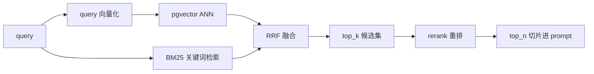

> 上一篇把 RAG 闭环跑通了，但有个环节我是故意留成「教学玩具」的：检索。内存里全量扫 + numpy 算余弦，能演示本质，不能上生产。
>
> 这一篇把它拆成三层升级：**性能靠 pgvector，召回靠混合检索，排序靠 rerank**。三层独立，按需叠加——不是全都要。

## 先说清楚，教学版检索差在哪

三个具体问题，对应三层升级：

| 问题 | 现象 | 升级手段 |
|---|---|---|
| 性能差 | n 个切片全量扫，O(n)，10 万切片每次查询算 10 万次余弦 | pgvector ANN 索引 |
| 召回漏 | 纯语义检索对精确词不敏感，错误码、函数名、型号被淹没 | 混合检索（BM25 + 向量） |
| 排序乱 | embedding 相似度衡量「像不像」，不是「相不相关」 | rerank 重排 |

先给结论：**这三层不是捆绑销售**。什么时候该升，见下一节。

## 什么时候该升级（避免过度工程）

| 场景 | 建议 |
|---|---|
| 切片 < 1k，内部工具 | 内存全量扫够用，别折腾 |
| 切片 1万+，或有并发查询 | 上 pgvector ANN |
| 查询里精确词多（错误码 / ID / 型号 / 函数名） | 加混合检索 |
| 答案准确性有硬要求（客服、法务、医疗、财务） | 加 rerank |

::: note
三层的代价是递增的：延迟涨、运维复杂、依赖变多。没有评测数据支撑的「精度升级」是自欺。先量化基线，再决定升哪层。怎么量化，下一篇讲。
:::

## 第一层：pgvector，把相似度算下推到库内

为什么不用内存全量扫：它是 O(n)，而且全部切片要驻留内存。pgvector 的 HNSW 索引是近似最近邻（ANN），查询复杂度接近 O(log n)，数据还留在库内，应用内存归零。

表结构就加一个向量字段，SQLAlchemy 2.0 原生支持：

```python
from pgvector.sqlalchemy import Vector
from sqlalchemy.orm import Mapped, mapped_column

class Chunk(Base):
    __tablename__ = "chunks"
    id: Mapped[int] = mapped_column(primary_key=True)
    content: Mapped[str] = mapped_column(Text)
    embedding = mapped_column(Vector(1024))  # 维度跟 embedding 模型锁死
```

查询时把距离计算交给数据库，一条 SQL 搞定：

```python
from sqlalchemy import select

distance = Chunk.embedding.cosine_distance(query_vec)  # <=> 算子
stmt = select(Chunk, distance.label("dist")).order_by(distance).limit(top_k)
rows = (await db.execute(stmt)).all()
# 余弦相似度 = 1 - dist
```

三种距离算子，按 embedding 性质选：

| 算子 | 含义 | 适用 |
|---|---|---|
| `<=>` | 余弦距离 | 默认，稳健 |
| `<->` | L2 距离 | 向量已归一化时，与余弦等价 |
| `<#>` | 负内积 | 文本向量常用 |

索引选型，HNSW 是默认答案：

| | HNSW | ivfflat |
|---|---|---|
| 查询 | 快 | 中 |
| 建索引 | 慢、吃内存 | 快 |
| 要调的参数 | m, ef_construction, ef_search | lists, probes |
| 建议 | 默认选它 | 批量导入期、内存紧 |

::: warning
小数据量别建索引。几千行以下，顺序扫比走索引还快，HNSW 建索引反而拖慢写入。等数据量上万再 CREATE INDEX。批量插入后跑 ANALYZE，让 planner 选对索引；HNSW 的 ef_search 调大召回率高但变慢，用 SET hnsw.ef_search 逐查询调。
:::

## 第二层：混合检索，把漏掉的精确词补回来

先看一个典型翻车：用户问「errcode 40164 怎么解决」。embedding 做的是语义近似，`40164` 这个 token 的语义权重很低，捞回来的可能是语义相近但根本不含这个错误码的段落。**答案正确，但答非所问。**

根因：bi-encoder 把整段压成一个向量，精确 token 被稀释。解法是双路召回——语义路由交给向量，精确路由交给关键词：

| 检索路 | 擅长 | 弱点 |
|---|---|---|
| 向量检索（pgvector） | 语义近似、同义改写 | 精确 token、专名 |
| 关键词检索（BM25） | 精确匹配、稀有词 | 同义、语序 |

两路各自返回候选排名，再融合。融合用 RRF（Reciprocal Rank Fusion）：

```text
score(d) = Σ 1 / (k + rank_i(d))     k 通常取 60
```

```python
def rrf_fuse(ranked_lists: list[list[str]], k: int = 60) -> list[tuple[str, float]]:
    scores: dict[str, float] = {}
    for ranked in ranked_lists:
        for rank, doc_id in enumerate(ranked, start=1):
            scores[doc_id] = scores.get(doc_id, 0.0) + 1.0 / (k + rank)
    return sorted(scores.items(), key=lambda x: x[1], reverse=True)
```

为什么是 RRF 而不是加权分数融合：两路的分数尺度完全不同（余弦相似度在 0~1，BM25 无上界），加权融合要调 α，换个数据集就崩。**RRF 只看排名，不看分数**，鲁棒、免调参。

::: note
中文是混合检索最容易踩空的地方。PostgreSQL 的 tsvector 内置配置不支持中文分词，to_tsvector('simple', ...) 会把整句当一个 token。要么上 pg_jieba / zhparser 扩展，要么把 BM25 独立出去用 Elasticsearch / Meilisearch，要么 jieba 分词后自建倒排。先把「中文能切对词」验证了，再谈融合。
:::

## 第三层：rerank，把候选集排序做准

混合检索解决「候选里有没有正确答案」，rerank 解决「正确答案排不排在前面」。两者是不同问题。

为什么向量检索排不准：bi-encoder 对 query 和 chunk 各编码一次再算距离，两者是独立编码，无法建模 query 与 chunk 之间的交互。相似度高不等于相关——「讲 embedding 原理的段落」和「讲 embedding 调用的段落」，对问题「怎么调 embedding API」可能相似度接近，但相关度差很远。

cross-encoder 的做法：把 (query, chunk) 拼成一个序列送进模型，直接输出相关度分数。精度高一档，代价也真实——每一对都要过一次前向推理，所以只对候选集做（比如 top 50），不能全库扫。

```python
class Reranker(Protocol):
    async def rerank(self, query: str, candidates: list[str], top_n: int) -> list[tuple[int, float]]: ...

class CrossEncoderReranker:
    def __init__(self, model_name: str = "BAAI/bge-reranker-v2-m3"):
        self.model = CrossEncoder(model_name)

    async def rerank(self, query, candidates, top_n):
        pairs = [[query, c] for c in candidates]
        # CPU 密集：必须 offload，别在事件循环里同步跑
        scores = await asyncio.to_thread(self.model.predict, pairs)
        order = np.argsort(scores)[::-1][:top_n]
        return [(int(i), float(scores[i])) for i in order]
```

::: warning
cross-encoder 推理是 CPU 密集活。在 async 接口里直接 self.model.predict() 会阻塞整个事件循环，所有并发请求一起卡死。必须 asyncio.to_thread offload，或独立成推理服务（TEI、Infinity）走 HTTP。这和第一篇「耗时活移出请求线程」是同一个道理：异步不解决 CPU 密集，async def 里塞阻塞调用不是异步化。
:::

## 三层怎么串起来

查询链路长这样，双路召回 → 融合 → 重排：



主干代码，注意三层是可插拔的：

```python
class HybridRetriever:
    def __init__(self, embedder, reranker=None, rrf_k=60, candidates=50, top_n=5):
        self.embedder, self.reranker = embedder, reranker
        self.rrf_k, self.candidates, self.top_n = rrf_k, candidates, top_n

    async def retrieve(self, db, query):
        # 1) 双路召回
        vec_hits = await self._vector_search(db, query, self.candidates)   # pgvector
        kw_hits = await self._keyword_search(db, query, self.candidates)   # BM25
        # 2) RRF 融合
        fused = rrf_fuse([[h.id for h in vec_hits], [h.id for h in kw_hits]], self.rrf_k)
        ids = [doc_id for doc_id, _ in fused[: self.candidates]]
        # 3) rerank（可选）
        if self.reranker:
            ranked = await self.reranker.rerank(query, [by_id[i] for i in ids], self.top_n)
            return [by_id[i] for i, _ in ranked]
        return ids[: self.top_n]
```

配置项和默认值，都该是 settings 而不是硬编码：

| 参数 | 作用 | 常见取值 |
|---|---|---|
| candidates | 双路召回的候选池 | 30~100 |
| rrf_k | RRF 平滑常数 | 60 |
| top_n | 送进 prompt 的切片数 | 3~8 |
| hybrid | 是否开混合检索 | 精确词多才开 |
| rerank | 是否开重排 | 精度要求高才开 |

分层抽象的价值和上一篇一脉相承：Retriever 是基类，HybridRetriever 是实现，业务层只认 retrieve() 这一个方法。换 pgvector 到 Qdrant、换 bge-reranker 到 Cohere，业务代码一行不动。

## 性能与代价，先算账再动手

| 层 | 延迟 | 精度收益 | 额外依赖 | 何时上 |
|---|---|---|---|---|
| 内存全量扫 | 基线 | 低 | 无 | 1k 切片以内 |
| pgvector ANN | 不增反降 | 性能为主 | PostgreSQL + pgvector | 1万+ 切片 |
| 混合检索 + RRF | +10~30ms | 召回中高 | 全文检索 / 中文分词 | 精确词查询多 |
| rerank | +50~200ms | 排序高 | 推理模型或服务 | 答案有硬要求 |

::: note
别三层无脑全上。每加一层都在用延迟和运维复杂度换精度。先测基线召回率，再对症下药。没测过的「提升」只是感觉，不是证据。
:::

## 总结

检索精度由三件事决定：**性能决定能不能用，召回决定答不答得对，排序决定答得准不准**。pgvector 解决性能，混合检索解决召回，rerank 解决排序。三层独立、按需叠加，别捆绑。

工程上真正要守住的还是那两条：耗时活移出请求线程，CPU 密集别硬塞 async。工具换了几轮，这两条没变。

> 下一篇讲怎么量化「检索好不好」——召回率、命中率、MRR，还有一套 RAGAS 评测流水线。没有评测的精度优化，都是在黑暗里挥拳。

::: note
工程源码是可运行的，RRF 融合与 rerank 抽象带单元测试。上一篇的最小闭环跑通后，直接替换 retriever 实现即可接入。
:::
